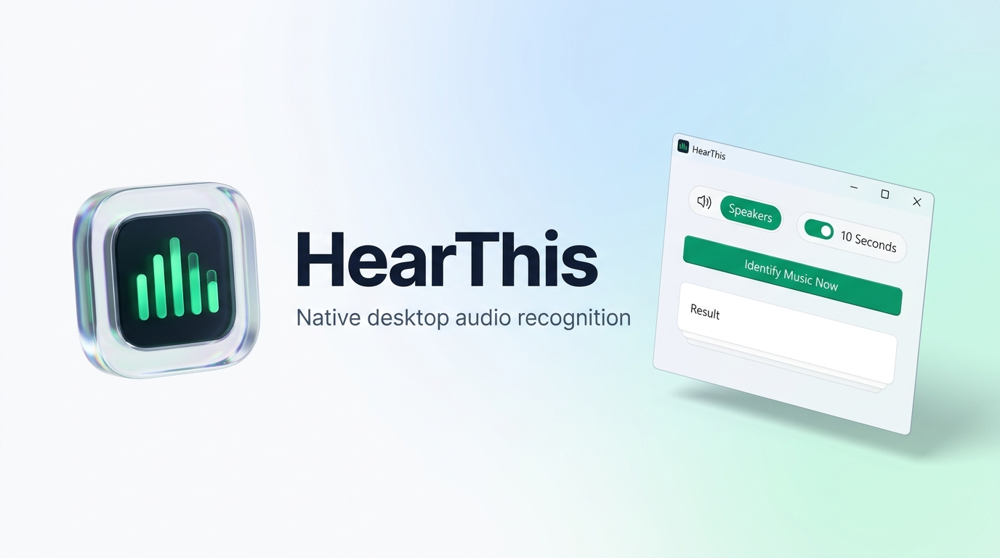
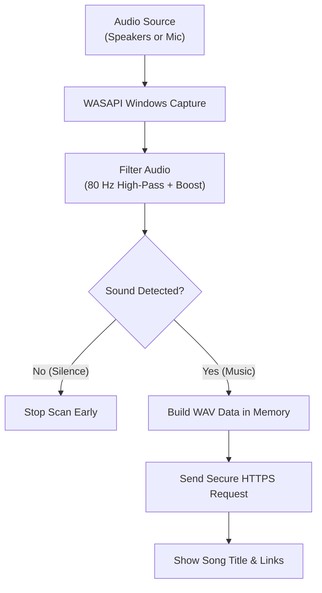

# HearThis

<p align="center">
  
</p>

[](https://en.wikipedia.org/wiki/C%2B%2B17)
[]()
[]()
[](LICENSE)
[]()

HearThis is a fast music recognition app for Windows. It identifies songs playing on your computer or in the room around you.

The app is completely native. It uses less than 400 KB of disk space and needs no extra runtimes like Python or web views.

---

## Why HearThis?

Most music apps only listen to your microphone. Others run slow web wrappers that use hundreds of megabytes of RAM.

HearThis solves these problems:

- **Listen to PC Audio**: Capture music directly from your speakers, browser, or games without any room noise.
- **Listen to Room Audio**: Capture songs from your phone, TV, or radio using your laptop or USB microphone.
- **Fast and Accurate**: Identifies tracks in seconds using ACRCloud and AudD music databases.
- **Light and Dark Themes**: Switch themes with one click. Your choice saves automatically.
- **Privacy First**: No tracking, no background services, and zero telemetry. It only sends audio when you click the scan button.

> [!TIP]
> Use the **Speakers** mode when you want clean audio from a YouTube video or stream. Use the **Mic** mode when you want to name a song playing in the room.

---

## Download and Quick Start

You do not need to install complex tools to run HearThis.

### 1. Download

Get the latest build from the **[Releases Page](https://github.com/deepesh70/song-detector/releases/latest)**:

- **Portable Zip**: Download `HearThis-v2.1.0-portable.zip`. Extract the folder and double-click `HearThis.exe`.
- **Installer**: Download `HearThis-Setup-v2.1.0.exe` for a standard Windows install wizard.

### 2. Add Your Free API Keys

HearThis needs an API key to identify music. Both supported services offer free plans:

1. Click **Get ACRCloud Keys** in the app to open the free ACRCloud signup page.
2. Create a free project and copy your **Host**, **Access Key**, and **Access Secret**.
3. Paste the keys into HearThis. The app saves them automatically for future sessions.

> [!NOTE]
> You can also select **AudD** as your provider if you prefer AudD tokens.

### 3. Identify Music

1. Start your music.
2. Select your audio source (**Speakers** or **Mic**).
3. Select your scan length (**5 Seconds** or **10 Seconds**).
4. Click **Identify Music Now**.
5. When the scan finishes, click **YouTube** or **Search Web** to open the track.

---

## Configuration

HearThis saves your settings in a simple text file:

```text
%APPDATA%\HearThis\config.txt
```

The file stores your choices:
- `theme`: Your selected theme (`dark` or `light`).
- `provider`: Your chosen service (`acrcloud` or `audd`).
- `source`: Your default input (`speakers` or `mic`).
- `duration`: Scan length in seconds (`5` or `10`).
- API credentials for each service.

If you ever want to reset the app, simply delete this file.

---

## How It Works



1. **Audio Capture**: Uses the native Windows Audio Session API (WASAPI) to record clear audio packets.
2. **Signal Filter**: An 80 Hz high-pass filter cuts low room rumble when using a microphone. A peak filter balances quiet sounds.
3. **Silence Gate**: If the room or PC is silent, the app stops early to save your monthly API requests.
4. **Direct HTTPS**: The app signs requests using Windows security libraries (`bcrypt.dll` and `winhttp.dll`) and sends them directly to the provider.

---

## Project Structure

```
HearThis/
├── CMakeLists.txt         # Build rules for CMake
├── build.bat              # Quick build script for MSVC
├── include/hearthis/      # C++ header files
│   ├── audio_processor.h  # Audio filters and WAV builder
│   ├── wasapi_capture.h   # Windows audio recording engine
│   └── api_client.h       # HTTPS network and cloud API client
├── src/                   # C++ source code
│   ├── audio_processor.cpp# Filter math and downmixing logic
│   ├── wasapi_capture.cpp # Windows COM WASAPI integration
│   ├── api_client.cpp     # WinHTTP and cryptographic signing
│   └── main.cpp           # Win32 user interface and theme engine
├── tests/                 # Automated test suites
├── assets/                # App icons and showcase banner
└── installer/             # Inno Setup installer script
```

---

## Building from Source

You can build HearThis on Windows 10 or Windows 11.

### Prerequisites

- A 64-bit Windows computer.
- A modern C++17 compiler (Visual Studio 2022 with C++ tools, or MinGW-w64).
- CMake 3.16 or newer.

> [!IMPORTANT]
> HearThis uses only native Windows system libraries (`winhttp`, `bcrypt`, `dwmapi`, `ole32`). You do not need to install any external C++ packages.

### Method 1: Using CMake

```cmd
cmake -B build
cmake --build build --config Release
ctest --test-dir build -C Release --output-on-failure
```

### Method 2: Using the Build Script

Run the automated build script in your terminal:

```cmd
build.bat
```

This script builds the test programs, runs all tests, and compiles the final `HearThis.exe` binary.

---

## Contributing and Portability

We welcome contributions and bug reports.

- **Portability**: HearThis relies directly on Windows audio and windowing APIs (WASAPI, Win32, DWM, and WinHTTP). Because of this, it runs only on Windows.
- **Reporting Issues**: If you encounter an audio error or device crash, please open a GitHub Issue and include your Windows version and audio device name.
- **Pull Requests**: Keep pull requests focused on one change. Ensure all unit tests pass before submitting code.

---

## License

HearThis is licensed under the [MIT License](LICENSE).
